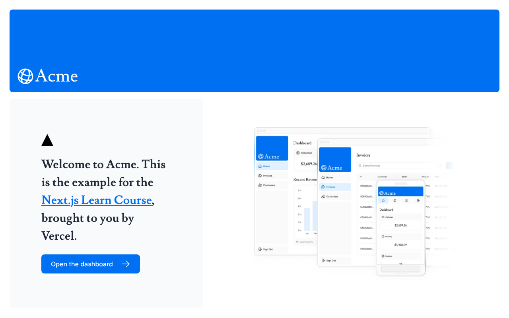
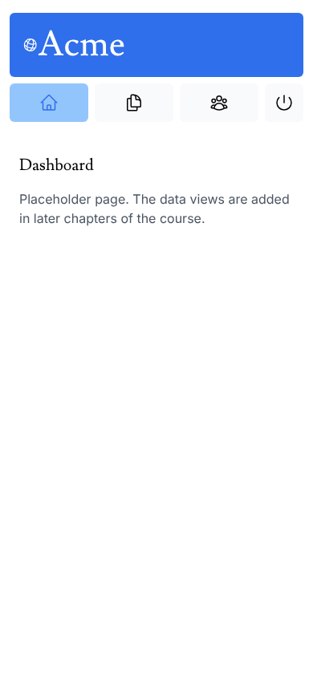

# Acme Dashboard (Next.js Learn course)

This repository is course work. It is based on the official [Next.js Learn](https://nextjs.org/learn) "App Router" dashboard course (the Acme invoices dashboard by Vercel). It is not original work: the Acme branding, the placeholder data (`app/lib/placeholder-data.ts`), the seed route, the data helpers and the UI components (`app/ui/*`) come from the course starter template. The repository is at an early stage of the course, so most dashboard pages are placeholders.

Live demo: https://nextjs-dashboard-hazel-zeta-25.vercel.app




## What is in the repo

- Landing page with the Acme hero (from the course).
- `/dashboard`, `/dashboard/invoices`, `/dashboard/customers`: placeholder pages inside the side navigation layout.
- `app/ui/*`: course components (cards, revenue chart, invoice table, forms, skeletons). Most of them are not used by any page yet.
- `app/lib/data.ts`: course queries against Postgres. Not called by any page yet.
- `/seed`: course route that creates the tables and inserts the placeholder data into Postgres.

Not implemented in this repo state: login (NextAuth is installed but not configured), invoice create/edit/delete actions, search and pagination wiring.

## Stack

Next.js 15 (App Router, Turbopack in dev), React 19, TypeScript, Tailwind CSS, Postgres via `postgres`, NextAuth v5 beta (installed, unused), Zod.

## Run it

```bash
pnpm install
cp .env.example .env     # fill in
pnpm dev
```

A Postgres database is needed only for the seed route and for the data helpers, which no page calls yet. The landing page and the placeholder dashboard pages run without one. I did not set up a database.

To seed (not run here): start the app and open `/seed`. In production this route returns 403 unless `ALLOW_SEED=true` is set.

### Environment variables (names only)

`POSTGRES_URL`, `POSTGRES_PRISMA_URL`, `POSTGRES_URL_NON_POOLING`, `POSTGRES_USER`, `POSTGRES_HOST`, `POSTGRES_PASSWORD`, `POSTGRES_DATABASE`, `AUTH_SECRET`, `AUTH_URL`, `ALLOW_SEED`. See `.env.example`.

## Demo data

All customers, invoices, revenue figures and the demo user in `app/lib/placeholder-data.ts` are the course's placeholder data. Nothing here is real.

## Changes on top of the course starter

- Fonts are self-hosted with `@fontsource` packages through `next/font/local`, so the build no longer needs access to Google Fonts (it failed offline before).
- `next`, `react` and `react-dom` were `latest`; they are pinned to the versions in the lockfile.
- Landing page button pointed at `/login`, which does not exist yet. It now opens `/dashboard`.
- Accessibility: side navigation icon links had no accessible name on mobile (text was `display: none`), now fixed; `nav` landmark, `aria-current`, focus outlines, page titles and `h1` headings.
- `/seed` is blocked in production unless explicitly enabled, because it is a public GET that writes to the database.
- Removed the unused `/query` scratch route, added a `typecheck` script and a GitHub Actions workflow (build and typecheck).

## How this was verified

`pnpm build` and `pnpm typecheck` pass with a placeholder `POSTGRES_URL`. The landing page and the dashboard pages were rendered in Chromium at 1280x800 and 390x844 with no horizontal overflow and no console errors, and `/seed` was confirmed to return 403 in a production build. Not run: anything that touches Postgres.

## Notes

UI and code quality improvements were made with AI assistance (Claude, Anthropic), reviewed and verified by building and running the app.
